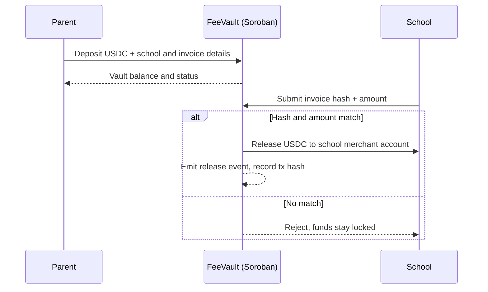

# FeeLock

**Earmarked school-fee savings on Stellar. Parents save in USDC, and the money goes to the school only when a matching invoice is presented.**

FeeLock is built around **FeeVault**, a Soroban smart contract that holds USDC deposits set aside for school fees. Each vault records which school it is for, and it releases funds to that school's merchant account only when the school submits an invoice whose hash and amount match. This repository holds the testnet MVP.

> **Status:** Testnet MVP (Instawards 30-day sprint, starting 1 December 2026). No real money moves through this project.

---

## Why FeeLock

There is no formal school-fee savings plan between parents and schools. Many parents struggle to pay school fees and rely on cash or informal arrangements, which makes it hard to keep money set aside for education. Schools have no reliable way to reconcile payments or link saved money to a specific invoice.

FeeLock solves both sides. Parents save with a clear purpose, and schools get paid against a verified invoice, with every step recorded on-chain.

## Features

### FeeVault contract (Soroban, Rust)
- Holds earmarked **USDC** deposits for each parent and vault
- Records the intended **school merchant account**
- Releases funds **only** when a matching invoice hash and amount are submitted
- Emits an event and records the transaction hash for every release
- Accepts USDC only

### Parent prototype
- Deposit USDC into a FeeVault with school and invoice details
- View vault balance and status

### School prototype
- Submit an invoice hash and amount for matching
- Receive the USDC release on testnet when the invoice matches

## How it works



1. A parent opens a vault for a school and deposits USDC, tagged with the school and invoice details.
2. The vault holds the funds and stores the school's merchant account.
3. The school submits the invoice hash and amount.
4. If both match what the vault expects, FeeVault sends the USDC to the school and emits an event. If not, the money stays locked.

## Matching rules

A release goes through only when all of these are true:
- The submitted **invoice hash** matches the hash stored for the vault
- The submitted **amount** matches the invoice amount
- The receiving account is the **school merchant account** recorded on the vault
- The vault holds enough USDC to cover the amount

Anything else is rejected and the funds stay in the vault.

## Contract interface (planned)

The exact names will be finalised in week 1. The planned functions are:

| Function | Who calls it | What it does |
| --- | --- | --- |
| `create_vault` | Parent | Opens a vault linked to a school merchant account |
| `deposit` | Parent | Adds earmarked USDC to the vault with invoice details |
| `submit_invoice` | School | Submits an invoice hash and amount for matching |
| `release` | Contract | Sends USDC to the school when the invoice matches, and emits an event |
| `get_vault` | Anyone | Reads a vault's balance, school and status |

## Tech overview

| Layer | What it uses |
| --- | --- |
| Smart contract | Soroban (Rust), compiled to Wasm |
| Asset | USDC on Stellar testnet |
| Prototypes | Parent deposit UI and school invoice UI |
| Network | Stellar testnet |

## Getting started

### Prerequisites
- [Rust](https://www.rust-lang.org/tools/install) with the `wasm32-unknown-unknown` target
- [Stellar CLI](https://developers.stellar.org/docs/tools/cli)
- A Stellar testnet account funded through Friendbot, with a USDC trustline

### Build and test the contract
```bash
git clone <repo-url>
cd feelock
rustup target add wasm32-unknown-unknown
cargo test
stellar contract build
stellar contract optimize --wasm target/wasm32-unknown-unknown/release/feevault.wasm
```

### Deploy to testnet
```bash
stellar contract deploy \
  --wasm target/wasm32-unknown-unknown/release/feevault.optimized.wasm \
  --source <your-testnet-identity> \
  --network testnet
```

Keep secret keys in your local Stellar CLI identity or a `.env` file. Never commit them or put them in this README.

## Roadmap (30-day sprint)

| Week | Work | Output |
| --- | --- | --- |
| 1 | FeeVault interfaces, vault and invoice data model, matching rules, repo scaffold | Compiling FeeVault skeleton; invoice and vault JSON schema |
| 2 | Deposit, earmarking, invoice-hash matching, conditional USDC release; parent and school prototypes | Local tests passing; deposit and invoice submission demo |
| 3 | Testnet deployment, USDC release to the school merchant account, end-to-end tests | Testnet transaction hash for a USDC release on a matching invoice |
| 4 | Edge-case hardening, demo video, docs, Wasm packaging | Final repo, Wasm, demo video and transaction hash |

## Deliverables and evidence

| Deliverable | Evidence |
| --- | --- |
| 1. FeeVault Soroban contract | This repo and the optimized Wasm file; README with build, deploy and matching-rule docs |
| 2. Parent deposit and school invoice integration | Transaction hashes showing a parent USDC deposit and a school invoice submission; release happens only on a match |
| 3. Testnet USDC release flow | Demo video or screenshot and a testnet transaction showing USDC moving from FeeVault to the school merchant account |

Links and transaction hashes are added to [`EVIDENCE.md`](EVIDENCE.md) as each deliverable is completed.

## Out of scope for this sprint
- Mainnet deployment, FSP or custody licensing, legal agreements and production KYC/AML
- Full production mobile apps, school onboarding beyond test data, and yield on saved funds
- Debt or credit features, and multi-school reconciliation beyond a single-vault demo

## What comes next
- Applying for the Stellar Community Fund (SCF) Build Award and a follow-on Instaward
- Seeking other ecosystem support

## Team
- **Builder:** Thamsanqa Cibi
- **Contact:** feelock@gmail.com
- **Ambassador Chapter:** South Africa, led by David Ogoegbunem

Built on [Stellar](https://stellar.org) and Soroban with support from the Stellar Instawards program.
